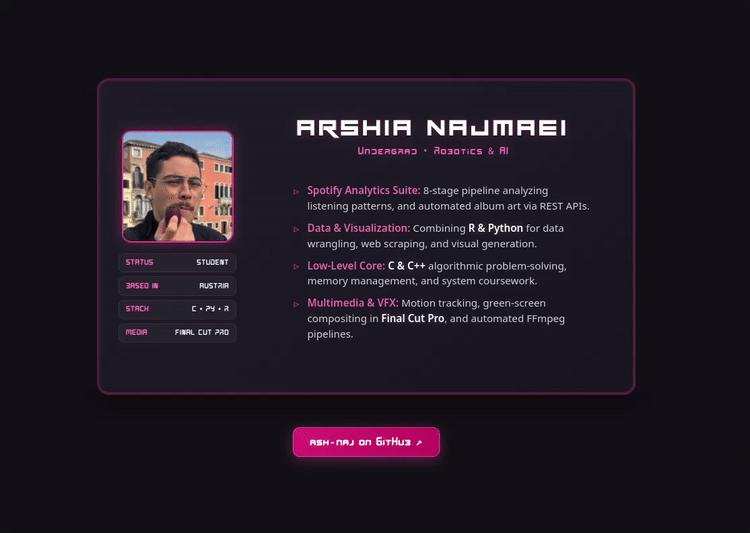

# Digital Dossier // Interactive 3D Profile Card

[](https://pages.cloudflare.com/)
[](https://developer.mozilla.org/)
[](https://archlinux.org/)

An interactive, cyber-minimalist digital dossier built with pure HTML5 and CSS3. Features a zero-dependency 3D perspective flip between a front-facing credentials badge and an Arch-themed `fastfetch`/`unixporn` terminal readout.

---

## ⚡ Preview

<div align="center">
  
</div>

> **Live Demo:** *I don't have the link yet :(*

---

## 🛠️ Architecture & Features

- **Pure CSS 3D Transformation:** Driven by `perspective: 1200px`, `transform-style: preserve-3d`, and hardware-accelerated GPU layers (`translateZ(0)`) for smooth 60fps rotations.
- **Dual-Faced Design:**
  - **Front:** Spec badge featuring dynamic tech tags, highlighted project breakdowns, and cyber-pink accent glow (`#ec4899`).
  - **Back (`fastfetch` / terminal):** Linux system spec readout with embedded Braille ASCII moon-cat art and custom status indicators.
- **Zero Framework Overhead:** Built entirely with vanilla HTML5 and modular CSS3 custom properties (`:root` tokens). No heavy JS bundles or external runtime libraries.
- **Typography:** Custom font integration pairing industrial headline geometry with technical monospaced body readouts.

---

## 📂 Project Structure

```text
.
├── index.html                  # Core markup & card face structure
├── Styles/
│   └── Profile_Card_style.css  # 3D transforms, design tokens, layout
├── Fonts/                      # Custom typography assets
└── Images/                     # Profile avatar & graphical assets
```

---

## 🚀 Local Development

1. Clone the repository:
   ```bash
   git clone [https://github.com/ash-naj/](https://github.com/ash-naj/)<repo-name>.git
   cd <repo-name>
   ```

2. Open locally:
   - Double-click `index.html` to run in any browser.
   - Or use VS Code Live Server / Python HTTP server:
     ```bash
     python -m http.server 8000
     ```

---

## 🌐 Deployment

The project is configured for continuous deployment on **Cloudflare Pages**:
- **Build command:** *None* (Static HTML/CSS)
- **Build output directory:** `/` (root)